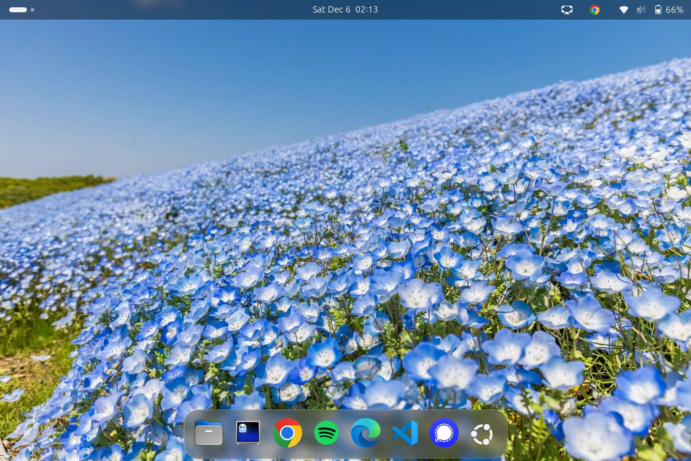
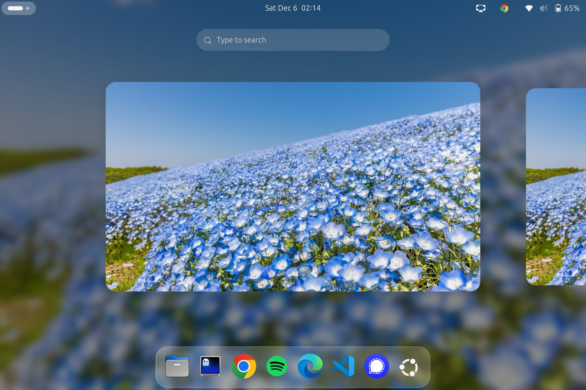
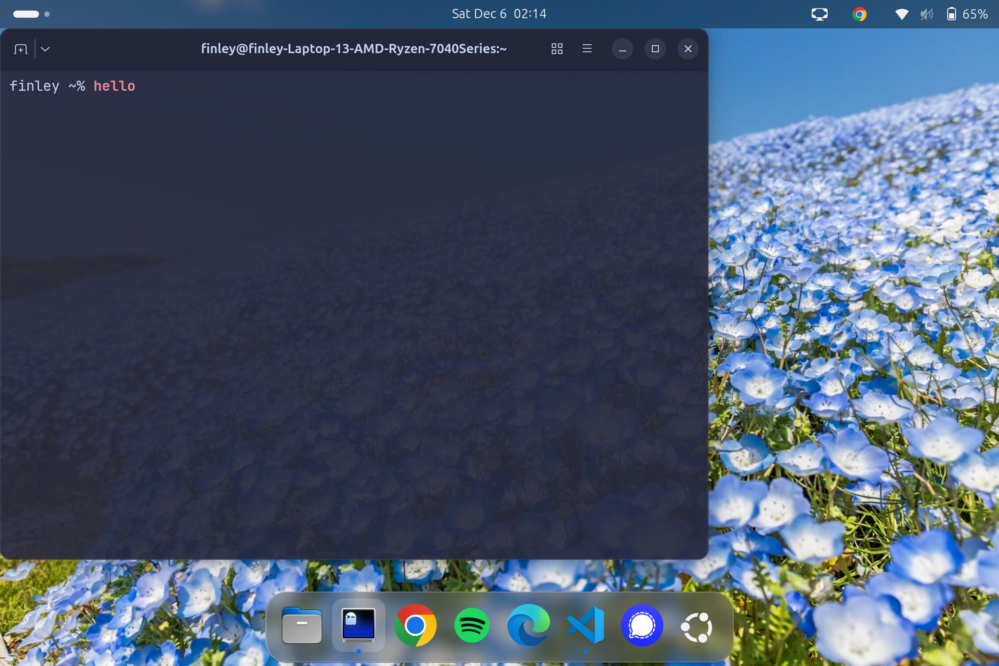

# linux-setup

My GNOME desktop, dotfiles, and everyday packages, installed with one script on
Arch or Ubuntu.





## Install

Start from a working GNOME desktop: Arch with the `gnome` group, or Ubuntu
24.04 or newer.

```bash
git clone https://github.com/FinleyHolt/linux-setup.git ~/Github/linux-setup
cd ~/Github/linux-setup
./setup.sh
```

Run it as your user: it calls sudo where it needs root, and `chsh` asks for
your password if your login shell changes. Log out and back in when it
finishes, so GNOME loads the new extensions and zsh becomes your shell.

Each step also runs on its own, and every step is safe to re-run:

```bash
./setup.sh packages   # the lists in packages/, plus a few direct installs
./setup.sh dotfiles   # Oh My Zsh, then symlinks for zshrc, nvim, ghostty, bin/
./setup.sh gnome      # extensions, settings, wallpaper, dock favorites
```

## What it does

**Packages.** On Arch, `pacman -Syu` installs `packages/arch.txt`, then
[yay](https://github.com/Jguer/yay) (bootstrapped if missing) installs
`packages/aur.txt`. On Ubuntu, apt installs `packages/ubuntu.txt` and snap
installs `packages/snap.txt`. Snap covers apps that apt lacks or ships too
old, such as Neovim, Ghostty, and VS Code. On both distros the script also
installs micromamba, uv, Claude Code, and a stable Rust toolchain, and
enables `tailscaled`.

**Dotfiles.** The script symlinks `zshrc` to `~/.zshrc`, `nvim/` to
`~/.config/nvim`, `ghostty/config` to `~/.config/ghostty/config`, and each
script in `bin/` into `~/.local/bin`. Any
file already in one of those places is first moved to
`<file>.bak-<timestamp>`. It also points [cheat](https://github.com/cheat/cheat)
at `cheatsheets/`.

- **zsh**: Oh My Zsh with syntax highlighting and autosuggestions, a plain
  `user ~/path %` prompt, micromamba, and `y` to open yazi and stay in the
  directory you left it in.
- **Neovim**: lazy.nvim with Telescope, Neo-tree, Treesitter, Mason LSPs
  (pyright, ruff, clangd, bashls), blink.cmp, conform, gitsigns, DAP, and
  Catppuccin. Keymaps are in [`cheatsheets/nvim`](cheatsheets/nvim).
- **Ghostty**: Catppuccin Macchiato, slight transparency, tabs in the
  titlebar, JetBrainsMono Nerd Font.
- **Remote sessions that survive sleep**: `moshr HOST [SESSION]` moshes in
  and attaches a tmux session, so a shut lid or a new network is only a pause.
  `sshr HOST [SESSION]` does the same over plain ssh for hosts without
  `mosh-server`, redialing and reattaching whenever the connection dies.
  Leave off SESSION and `tmux-pick` shows a menu of the host's sessions,
  newest first, with each one's title and a live preview of its screen.
  Ctrl-S in the menu skips tmux and opens a plain ssh shell instead. A bare
  `ssh HOST` runs moshr for the hosts in `MOSHR_HOSTS`, and `MOSHR_ALIASES`
  points a bare `ssh NAME` at another host's menu (both set per machine in
  `~/.config/zsh/*.zsh`).

**GNOME.** The script installs Blur my Shell, Dash to Dock, Caffeine, Custom
Hot Corners Extended, and Tiling Assistant from extensions.gnome.org. It then
loads [`gnome/settings.ini`](gnome/settings.ini): dark style, blue accent, a
translucent blurred dock at the bottom, and the bottom-right hot corner
opening the overview. It also sets the wallpaper and pins the dock favorites.
On Ubuntu it disables Ubuntu's own dock and uses the Yaru blue theme.

## Make it yours

- Edit the files in `packages/` to change what is installed.
- Edit `gnome/settings.ini` for desktop settings. `dconf dump /org/gnome/`
  shows what your current desktop uses.
- Keep machine-specific shell config and secrets out of the repo. The zshrc
  sources every `~/.config/zsh/*.zsh`, then `~/.zshrc.local`, and neither
  location is tracked.

## Notes

- A few tools come from their vendors' install scripts, piped from `curl` over
  HTTPS: Claude Code, uv, and Zed (Ubuntu only). The Ubuntu path also fetches
  the Tailscale apt key and the Chrome `.deb` from their vendors. Read
  `setup.sh` before you run it.
- `fastfetch` and `rnote` are left out on Ubuntu 24.04, which does not package
  them.

## License

MIT. The wallpaper photo is not covered by the license.
